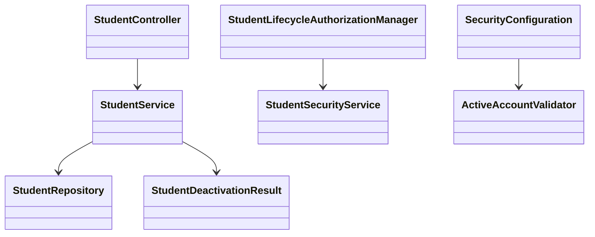

# Student Design

> Realizes: UC-STU-deactivate-student.
> Depends on: FR-SEC-authentication, FR-SEC-active-account.
> Related behavior changed: UC-EVA-submit-evaluation and UC-EVA-section-evaluation-report.
> Sources: [use cases](../requirements/use-cases.md), [business rules](../requirements/business-rules.md), [SRS](../requirements/software-requirements-specification.md), and the [architecture-of-record](architectural-design.md#architectural-conventions).

## Overview

Extend the existing student vertical slice. Deactivation uses the existing account flag and retained relationships under BR-student-lifecycle. Reuse the architecture's Spring Security, Result envelope, exception advice, domain services, and shared SPA request client. No new deployable or database schema is introduced. This design does not implement UC-STU-reactivate-student.

## Components and responsibilities

Paths below are relative to the repository root; existing files are revised rather than replaced.

| Component | Reuse or new | Responsibility |
|---|---|---|
| `frontend/src/pages/students/Students.vue` | Reuse | Dedicated action, named-student warning, confirmation/cancellation, success feedback, refresh |
| `frontend/src/pages/students/EditStudentForm.vue` | Reuse | Active accounts have read-only status; generic profile editing cannot deactivate |
| `frontend/src/apis/student/index.ts` | Reuse | Dedicated request using the existing shared request client |
| `student/StudentController.java`, `student/StudentService.java` | Reuse | Endpoint and transactional `deactivateStudent(Integer studentId)` returning `StudentDeactivationResult(Student student, boolean changed)` |
| `student/StudentDeactivationResult.java` | New | Carry the current student and changed flag so the controller distinguishes a harmless repeat |
| `student/StudentRepository.java`, `student/Student.java` | Reuse | Existing account persistence and team relationship |
| `student/StudentSecurityService.java` | Reuse | Target-specific lifecycle predicate; do not change unrelated authorization predicates |
| `security/authorizationmanagers/StudentLifecycleAuthorizationManager.java` | New | Read the bound studentId and require an owning course admin or assigned course-section instructor |
| `security/ActiveAccountValidator.java` | New | Validate current account state through UserRepository for a signed JWT's userId |
| `security/SecurityConfiguration.java` | Reuse | Register the dedicated route and compose active-account validation with standard JWT validation |
| `evaluation/EvaluationService.java` | Reuse | Guard create and update eligibility; apply weekly report inclusion |
| `evaluation/PeerEvaluationAverage.java` | Reuse | Add account `enabled` to report output, without changing score calculation |
| `frontend/src/apis/evaluation/types.ts` | Reuse | Match the additional report field |
| `frontend/src/pages/evaluations/SubmitTeamsEvaluations.vue` | Reuse | Exclude inactive targets from both new and loaded update rows; refresh on stale eligibility failure |
| `frontend/src/pages/evaluations/admin/SectionsEvaluations.vue` | Reuse | Show the Inactive label beside the included student's name |

Backend paths in the table begin at `backend/src/main/java/team/projectpulse/`.

## Implemented class relationships



The evaluation converter uses the caller's team for create lookup and `convertForUpdate` defers target identity to the stored evaluation. `peerEvaluationRows.ts` is a pure active-roster projection shared by initial loading and failure refresh; Node tests supplement the planned Cypress contracts. There is no schema change.

## Sequence

```mermaid
sequenceDiagram
    actor Instructor
    participant UI as Student Management
    participant API as StudentController
    participant Service as StudentService
    participant DB as Database
    Instructor->>UI: Select student and Deactivate (steps 2-3)
    UI-->>Instructor: Named warning and consequences (step 4)
    alt Cancel (5a)
        Instructor->>UI: Cancel or dismiss
        UI-->>Instructor: Close without a mutation request
    else Confirm (step 5)
        Instructor->>UI: Confirm
        UI->>API: PATCH /students/{studentId}/deactivation
        API->>API: Authenticate and enforce lifecycle guard
        alt Unauthorized (2a)
            API-->>UI: 401 or 403 Result; no mutation
        else Authorized
            API->>Service: deactivateStudent(studentId)
            Service->>DB: Read current student
            alt Already inactive (3a)
                Service-->>API: Current student; already-deactivated outcome
            else Active
                Service->>DB: Persist enabled=false only (step 6)
                Service-->>API: Current student; deactivated outcome
            end
            API-->>UI: 200 Result with StudentDto and outcome message
            UI-->>Instructor: Feedback and refreshed roster
        end
    end
```

On the student's next protected request after the deactivation transaction commits, JWT decoding checks current account state before route authorization. A newly disabled account produces the existing authentication-failure response and SPA sign-in redirect. A request already executing when deactivation commits is not promised retroactive cancellation.

## API contract

All paths are under `/api/v1`; reuse the Result envelope and existing StatusCode constants.

| Endpoint | Caller and request | Success | Errors or alternatives |
|---|---|---|---|
| `PATCH /students/{studentId}/deactivation` | Owning course admin or assigned course-section instructor; no body | 200, current StudentDto, message `Student deactivated successfully` | Authorized inactive repeat: 200 and `Student is already deactivated.`; 401 unauthenticated; 403 unauthorized or unresolved target at the guard; 404 if a target disappears after authorization |
| `PUT /students/{studentId}` | Existing profile-edit caller and StudentDto | Existing profile response when not attempting deactivation | Active-to-inactive payload: 400, `Use the dedicated deactivation action.`; no profile or account changes |
| `POST /evaluations` | Existing authorized evaluator and existing evaluation payload | Existing response for an eligible target | Inactive target: 400 using PeerEvaluationIllegalArgumentException, before any save |
| `PUT /evaluations/{evaluationId}` | Existing authorized evaluator and existing update payload | Existing response while eligible and in the submission window | Inactive stored evaluatee: 400 before rescoring or changing comments |
| `GET /evaluations/sections/{sectionId}/week/{week}` | Existing authorized report caller | Existing weekly report with `enabled` on averages and inclusion per BR-inactive-student-reporting | Existing permission/input errors remain in effect |
| Protected requests with Bearer JWT | Existing token | Existing response if current account is active and route permission passes | Disabled, missing, or unresolvable account: 401; preserve signature and expiration rejection |

The permission guard checks a target's actual course section and course, not the caller's selected/default course section. Reuse CourseSecurityService.isCourseOwner and StudentSecurityService's assigned-course-section lookup, combined with the appropriate role. Guards fail closed on missing or malformed identifiers. A global admin role alone does not grant access to another course's students. Authorization happens before the repeat outcome is disclosed.

The service also enforces caller scope in the persistence query, as required by the architecture's two enforcement points. Add a lifecycle lookup taking studentId and the authenticated actorId, with a predicate matching the student's course admin or assigned course-section instructor; do not trust a body/default-course id or load by id and compare afterward. Return the existing not-found outcome when the scoped lookup finds no row. Evaluation creation resolves the target by id and the authenticated evaluator's current team; updates resolve the evaluation by id and authenticated evaluator id, then use its stored target. Report selection constrains course-section id and instructor/course-owner scope in the query. Test each scoped finder and denied mutation independently of the route guard.

The frontend warning names the student and explains access revocation, preserved team membership/work, exclusion from new and updated evaluations and reminders, and retained historical report results. Cancel, Escape, and dialog dismissal send no mutation request. Disable confirmation while its request is pending; refresh after success and do not display success after an error.

## Decisions and rejected alternatives

- **Dedicated idempotent action.** Use PATCH with no account-status body and set only enabled. Rejected generic profile mutation because it mixes lifecycle and profile changes and bypasses the warning. Validate an attempted generic deactivation before changing profile fields. Preserve the pre-existing legacy reactivation behavior; do not add a dedicated reactivation flow or broaden its permissions. The edit form's existing reactivation control may remain for accounts initially inactive, while active accounts cannot use it to deactivate.
- **Current database state on every JWT request.** ActiveAccountValidator uses UserRepository and the signed userId claim. Compose it with the decoder's default validators, rather than replacing timestamp validation. Reject absent/malformed ids and disabled/missing accounts; a lookup failure must never authenticate the request. Rejected waiting for expiry, a status claim embedded in the token, a TTL cache, and a new revocation table: these either leave an access window or add unnecessary state. Cost: one account lookup per authenticated JWT request.
- **Both evaluation write paths enforce eligibility.** Re-read the relevant persisted target in the request's transaction. On update, derive target identity from the stored evaluation, not a caller-supplied replacement id. Validate before modifying ratings/comments. Rejected frontend-only filtering and a create-only check because direct requests, old screens, and updates would still violate BR-active-peer-evaluatee. Preserve previous-week/rubric/ownership validation. Existing requests represent individual evaluations, not an atomic batch of an entire team's evaluations.
- **Historical report selection is independent of current authoring eligibility.** Keep scores/comments already stored, including work written by an evaluator who later became inactive. For currently inactive students, test for saved evaluations targeting that student for the selected week before calculating/adding a row. Include such historical rows even if membership was separately removed later; active-student inclusion retains its existing behavior. Set enabled on every generated average. Rejected hiding every inactive student and showing empty zero-grade rows, per BR-inactive-student-reporting. Do not change grade calculations.
- **Keep existing reminder ownership.** SubmissionStatusService already applies BR-submission-owed. Exercise it as a regression rather than adding a second definition of missing work or an evaluation-to-notification dependency.

## Data model and architecture delta

No table, relationship, timestamp, or migration changes. Student inherits the persisted enabled flag from PeerEvaluationUser; deactivation writes that flag only. Retain the existing team and evaluation associations. The added enabled field is an API-report projection, not persisted data. See the SRS's [business domain model](../requirements/software-requirements-specification.md#business-domain-model).

Security adds one validator inside the existing security component. The component boundaries, authentication mechanism, and deployment topology remain the same. The architecture-of-record's authentication prose should be updated during implementation to reflect current-account validation; its broader statement about lack of general JWT revocation remains valid. Do not describe deactivation as a token blacklist.

## Test list

These rows are obligations for implementation, not claims that tests already exist or pass. Backend integration tests use the existing MySQL Testcontainers setup; browser tests use existing Cypress.

| Row | Flow and oracle | Level | Required assertion |
|---|---|---|---|
| authorized-deactivation | UC-STU-deactivate-student step 6; BR-student-lifecycle | Unit + integration | Assigned instructor and owning course admin succeed; enabled=false; student/team identity and saved activities/evaluations remain unchanged |
| no-team | Step 6; BR-student-lifecycle | Unit | Student without a team can be deactivated without null dereference or a new assignment |
| repeat | Extension 3a | Unit + integration | Authorized repeat returns the chosen message and changes no records, including when no active students remain |
| forbidden | Extension 2a; BR-student-lifecycle | Real filter-chain integration | Student, unrelated instructor, and admin of another course receive 403; no mutation; unauthorized inactive repeat is also denied |
| missing-auth | FR-SEC-authentication | Integration | Missing credentials produce 401 on the dedicated route |
| unresolved-target | Architecture authorization convention | Integration | Missing/malformed target cannot pass the guard; no mutation or exception disclosure |
| warning | Steps 3-5 and Associated Information | Cypress | Dedicated action identifies the student and displays the specified consequences before confirmation |
| cancel | Extension 5a | Cypress | Cancel/dismiss sends zero deactivation requests and preserves the displayed account status |
| confirm | Steps 5-6 | Cypress | Confirmation sends the dedicated PATCH, shows success only after success, and refreshes status; request failure is not presented as success |
| profile-bypass | Dedicated-action decision | Unit + integration | Generic active-to-inactive update returns 400 before profile/account changes; ordinary profile edits still work |
| live-token | Associated Information; FR-SEC-active-account | Real-token integration | Issue an actual valid token, successfully call a protected route, deactivate, then receive 401 with that same token; do not use a mock Jwt postprocessor as the sole evidence |
| auth-regression | FR-SEC-active-account; FR-SEC-authentication | Integration + validator unit | Disabled login fails; active accounts still work; missing/malformed account claims, disabled instructors, deleted accounts, bad signatures, and expired tokens remain denied |
| auth-lookup-failure | FR-SEC-active-account | Validator unit + Cypress | Database/account lookup failure does not authenticate; a real 401 clears the SPA token and redirects to sign-in |
| create-inactive | BR-active-peer-evaluatee; EVA extension 9a | Unit + integration | Inactive target yields 400 and no evaluation is inserted; active target succeeds in an open window |
| update-inactive | BR-active-peer-evaluatee; BR-evaluation-editable-until-close | Unit + integration | Inactive stored target yields 400; saved ratings and both comments are unchanged; active open-window update remains possible |
| update-target-identity | BR-active-peer-evaluatee; architecture scoped persistence | Unit + integration | A replacement evaluatee id in the payload cannot retarget an evaluation or bypass eligibility of its stored evaluatee |
| eligible-ui | EVA main steps 2/4 and extension 9a | Cypress | Inactive targets are absent from new and loaded update rows; stale-target rejection refreshes eligibility and leaves the form usable |
| historical-report | BR-inactive-student-reporting | Unit + integration + Cypress | Inactive student with target-week results remains with original results and Inactive label; no-results inactive student is absent; active rows remain; results from other weeks do not qualify |
| historical-retention | BR-student-lifecycle; BR-inactive-student-reporting | Unit + integration | Retain results written by an inactive evaluator and include an inactive target with saved evaluations after a separate membership removal |
| reminder-regression | BR-submission-owed | Unit or integration | Inactive student owes neither record and is not a reminder recipient; remaining active teammates do not owe evaluations of that student |
| scoped-persistence | Architecture two enforcement points; BR-section-scoped-access and BR-team-scoped-access | Repository integration + service unit | Lifecycle/report/evaluation lookups themselves constrain caller scope; foreign ids yield no data or mutation even without a route-level guard |
| existing-negative-flows | EVA submit extensions 1a/1b/1c/4a and report 4a/5a | Existing unit/integration tests plus additions where absent | Inventory and run existing week-window, missing-team, invalid-input and empty-report coverage; name any unverified flow in the build PR and trace instead of assuming it passes |

## Implementation order and verification

1. **Trunk commit:** add and exercise current-account JWT validation first. Run focused validator/security tests and read that shared change before adding leaves. Preserve existing decoder validation.
2. **Lifecycle/security commit:** add the route, target-specific guard, transactional service, and generic-update bypass protection with their tests.
3. **Evaluation/report commit:** enforce eligibility on both write paths; add report status/inclusion and regression tests without changing reminder policy.
4. **UI commit:** dedicated confirmation, profile protection, active-only evaluation rows, and historical status label; Cypress tests trace to the rows above.
5. Run backend tests with Docker available, frontend type/build checks, and the selected Cypress tests against the running app. Record actual commands and results, including existing failures and unverified rows, rather than masking them.
6. Mutation-check the least-trusted test by changing one production line, run it red, restore production code, then rerun green. Record the exact test, mutation, and observed result in the build PR.
7. Update traceability Build and Verify independently; identify each tested extension and any untested row. Open the build PR with Closes #1 and a link to the merged design PR, then leave it open.

## Review boundaries

Calendar-week validation remains owned by the existing evaluation service and injected Clock. Token validation retains real-time expiry. Deactivation is not deletion and never revokes access by removing team membership. No native builds, deployment, or new GitHub Actions are added. For any remaining contradiction, stop and settle it in the specification/design before implementing. The build PR must distinguish tests actually run from planned or blocked tests and contain the student's own review.

## Build verification status

See [deactivation-verification.md](deactivation-verification.md) for the row-by-row evidence and gaps. Build is implemented; Verify remains Partial. The database-dependent and browser scenarios are not claimed passed.
